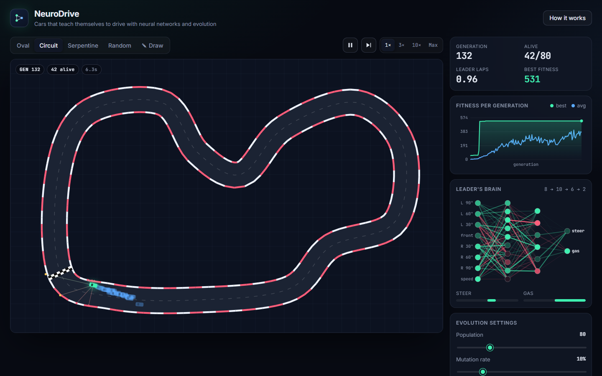

# 🧠🏎️ NeuroDrive: Neuroevolution Lab

[](https://github.com/brahmiAdem/neurodrive/actions/workflows/ci-cd.yml)

**Cars that teach themselves to drive.** Nobody writes the driving rules. Every car is controlled by a small neural network with random weights, and a genetic algorithm evolves those networks generation after generation until they can race around the track.

Everything runs in the browser in vanilla JavaScript and the Canvas API. There are **no libraries, no build step and no server**.

> **Live demo:** _add your GitHub Pages link here_



## Features

- **Live neuroevolution.** Watch 80+ cars learn the circuit in real time, or train at max speed.
- **Brain visualizer.** See the leading car's network with live neuron activations and its weights (green = positive, red = negative).
- **Fitness chart.** Best and average fitness per generation.
- **5 tracks.** Oval, Circuit, Serpentine, a procedurally generated **Random** track, and a **track editor** where you draw your own.
- **Race the AI.** Drive with the keyboard against the best brain evolved so far.
- **Save, load, export and import brains** as JSON. You can also seed a new population from a trained brain.
- **Tunable evolution.** Population size, mutation rate, mutation strength and track width.

## How it works

| Step | What happens |
|------|--------------|
| **Sense** | 7 ray-cast sensors (−90° … +90°) measure the distance to the walls. With the current speed they make the 8 inputs. |
| **Think** | A feed-forward network `8 → 10 → 6 → 2` (tanh) outputs **steering** and **throttle**. |
| **Score** | Fitness = checkpoints passed + a bonus for average pace + a bonus for finishing 3 laps. Cars die when they crash or stall. |
| **Evolve** | Elitism (top 3 survive) + tournament selection + uniform crossover + Gaussian mutation. |

### Engineering details

- **Fast ray casting.** Wall segments go into a uniform spatial grid. Rays walk the grid cell by cell (Amanatides–Woo traversal) and stop at the first confirmed hit, so hundreds of cars × 7 rays run at many simulation steps per frame.
- **Smooth tracks.** Control points are interpolated with a closed Catmull–Rom spline, then resampled by arc length. Walls, kerbs and evenly spaced checkpoints are built from that curve.
- **Flat weight vectors.** Each network keeps its weights in a single `Float32Array`, which makes cloning, crossover, mutation and serialization trivial.
- **Static track layer.** The track is pre-rendered to an offscreen canvas, so each frame only draws the cars.

## Project structure

```
neurodrive/
├── index.html
├── css/style.css
└── js/
    ├── main.js        # app state, main loop, UI, editor, race mode
    ├── nn.js          # neural network
    ├── evolution.js   # genetic algorithm
    ├── car.js         # car physics + sensors + fitness
    ├── track.js       # splines, walls, spatial grid, ray casting, presets
    └── render.js      # canvas drawing: track, cars, network, chart
```

## Run locally

The app uses ES modules, so serve it over HTTP instead of opening the file directly:

```bash
npm start          # http://localhost:5173 (no install needed)
```

## Testing

```bash
npm install
npx playwright install chromium   # first time only

npm run lint       # ESLint
npm test           # unit tests (node:test): network, GA, physics, ray casting
npm run test:e2e   # Playwright end-to-end tests, desktop + mobile
npm run ci         # all of the above
```

The unit tests include a property test: on 500 random rays, the grid-accelerated ray caster must agree with a brute-force check against every wall.

## CI/CD pipeline

[GitHub Actions](.github/workflows/ci-cd.yml) runs on every push and pull request:

```
 lint ──┐
        ├──► e2e (Playwright) ──► build ──► deploy to GitHub Pages
 unit ──┘                          └─ main branch only
 (Node 20 + 22)
```

| Stage | What it does |
|-------|--------------|
| **Lint** | ESLint over app, tests and scripts |
| **Unit** | `node --test` on Node 20 and 22 |
| **E2E** | Playwright drives the real app in Chromium (desktop + Pixel 7) and uploads an HTML report as an artifact |
| **Build** | Copies only `index.html`, `css/` and `js/` into `dist/` |
| **Deploy** | Publishes `dist/` to GitHub Pages. This runs only on `main`, and only if every check passed. |

Pull requests get the checks but are never deployed.

### One-time setup

1. Create a GitHub repository and push this folder to its `main` branch.
2. Go to **Settings → Pages → Build and deployment** and set *Source* to **GitHub Actions**.
3. Push to `main` and the site goes live at `https://<username>.github.io/<repo>/`.

## Keyboard shortcuts

| Key | Action |
|-----|--------|
| `Space` | Pause / resume |
| `N` | Skip to the next generation |
| `1`–`4` | Simulation speed (1×, 3×, 10×, Max) |
| `↑ ↓ ← →` / `WASD` | Drive in race mode |

## License

MIT
